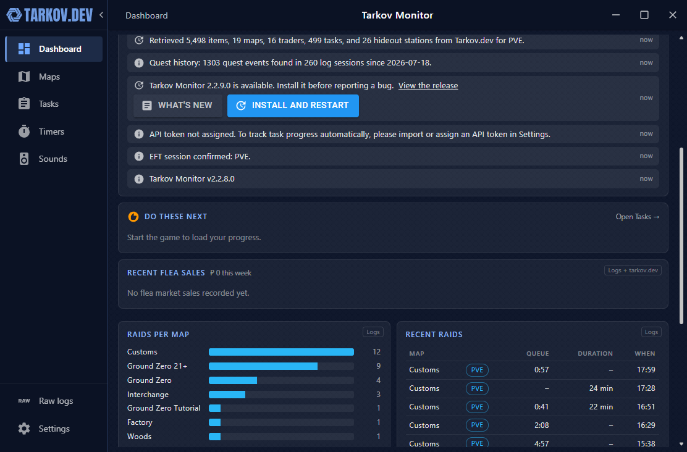
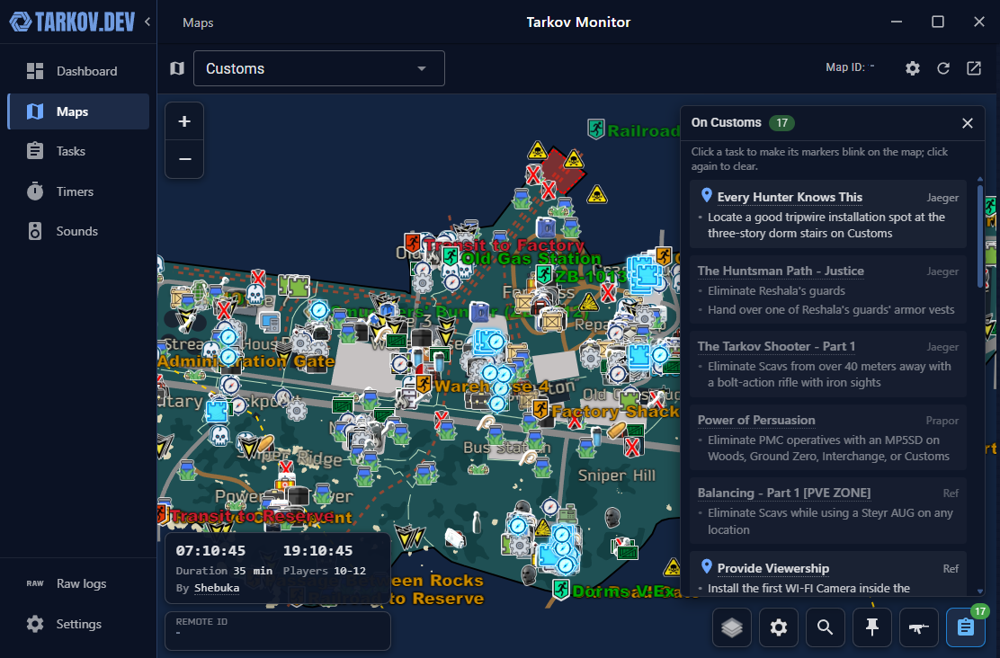
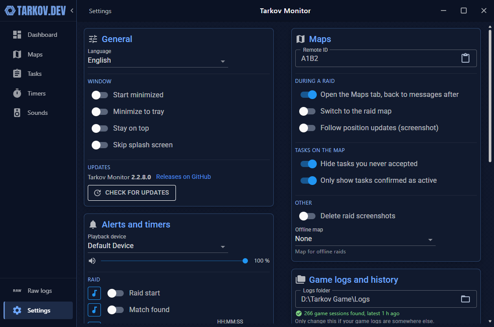

# Tarkov Monitor (fork)

[](https://github.com/Scholle1309/TarkovMonitor/releases/latest)
[](LICENSE.txt)

Tarkov Monitor is an Escape from Tarkov companion app. It reads the log files the game writes, plays audio alerts, keeps your task progress on [Tarkov Tracker](https://tarkovtracker.org) up to date, and shows the [tarkov.dev](https://tarkov.dev) map with your tasks right inside the app.

This is a fork of [the-hideout/TarkovMonitor](https://github.com/the-hideout/TarkovMonitor). It adds a dashboard, an embedded map with task, boss and marker panels, prestige tracking, backups and in-app updates. It is not an official tarkov.dev project; for the original app, use the upstream repository.



## Features

**Dashboard**
- Status of the game, Tarkov Tracker, tarkov.dev data and the map connection at a glance.
- Level, task and Kappa progress, hideout, raids and flea market sales.
- "Do these next" task recommendations, raids per map, queue times, raids per day, recent raids, recent flea sales and quest activity.
- A period filter for each character and prestige: "All", "Run 1", "Run 2", "Prestige 1" and so on. The choice is remembered.

**Maps**
- The tarkov.dev map is built in and opens on the map you are loading into.
- Tasks on this map: click one to make its markers blink, click the title to open the wiki.
- Bosses on this map with spawn chances and their most likely spawn zones.
- Your own markers: right-click the map to place one, with a headline, description, symbol, colour and the game modes it shows in.
- Layers, map settings and search sit in one dock next to the task and boss buttons.
- Tasks you never accepted are hidden from the map, based on your game logs and Tarkov Tracker progress.



**Tasks**
- All tasks with search, trader and map filters and a Kappa filter.
- Recommendations by current map, experience, Kappa, unlocks or a mix.
- Mark tasks as accepted or hide them, and jump to a task on the map.

**Progress and history**
- Task progress is sent to Tarkov Tracker as you complete tasks in game.
- Quest history is read from your game logs, so the app knows which tasks you accepted, finished or failed.
- A prestige or a new character is detected from the logs. Task history and recommendations then start over; raids and flea sales keep counting.

**Alerts and timers**
- Audio alerts for match found, raid start, run-through time, task restart, air filter, quest items and scav cooldown, each with its own sound if you like.
- Pick the playback device and the alert volume.
- A floating raid timer with elapsed raid time and run-through countdown.

**Settings and data**
- Backup and restore of raids, flea sales, quest history, map markers, custom sounds and settings in one file.
- Everything is stored locally on your PC.
- English and German, plus the languages from the original project.



## Installation

1. Open the [latest release](https://github.com/Scholle1309/TarkovMonitor/releases/latest) and download `TarkovMonitor.zip` under **Assets**.
2. Extract the zip into a folder of your choice.
3. Run `TarkovMonitor.exe`.

Tarkov Monitor needs the Microsoft Edge WebView2 runtime, which Windows 10 and 11 usually have. If it is missing, Tarkov Monitor downloads and installs it on first start.

## Updates

From version 2.2.11.0, Tarkov Monitor checks for a new release at startup and once a day. A popup shows the changelog with an **Update now** button; the app downloads the release, restarts and is up to date. You can also use **Check for updates** in the settings. Don't update during a raid.

Versions up to 2.2.10.0 only link to the release page. Install a current version once by hand; after that, updates come from inside the app.

## Setup

### Tarkov Tracker

1. Log in on [tarkovtracker.org](https://tarkovtracker.org), open the settings and create an API token with permission to read and write progression.
2. Copy the token with its copy button. The displayed token hides some characters, so selecting it by hand does not work.
3. In Tarkov Monitor, open **Settings › Tarkov Tracker** and choose **Import API token**.

Tarkov Monitor assigns the token to the right EFT profile and game mode. It marks tasks as complete while it is running. For tasks you finished before, see [reading past logs](#reading-past-logs).

### Map and tarkov.dev remote

The **Maps** tab uses the **Remote ID** from **Settings › Maps**. A short ID is created for you on first start. If you also have tarkov.dev open in a browser, click **Click to connect** there and use the same ID; the website then follows your raids as well.

Taking an in-game screenshot shows your position on the map. Turn on **Follow position updates** in the settings to switch the map with it.

### Reading past logs

**Settings › Game logs and history › Read past logs** lists the starting points found in your logs, by game version and profile. Pick the one at the start of the wipe or of your current character. Tarkov Monitor then reads everything from there, updates Tarkov Tracker and fills the quest history. Statistics count from that point on.

Close the game before reading past logs.

## FAQ

### How does Tarkov Monitor work?

It watches the log files the game writes while it runs. Many game events, like matching, raid start, task changes and flea market sales, appear in these logs.

### Is it a cheat?

Tarkov Monitor only reads log files the game writes to your PC. It doesn't touch the game, and the logs are not updated with raid details while a raid is in progress.

### Where is my data stored?

In `%APPDATA%\TarkovMonitor`, on your PC only. Use **Export backup** in the settings to save it, for example before reinstalling Windows. Tarkov Tracker tokens are not part of the backup, because Windows ties them to your user account on this PC.

### Can it update my hideout or PMC level on Tarkov Tracker?

No. The game doesn't log hideout construction or your PMC level, so these can't be updated automatically.

## Troubleshooting

- **"Invalid WebView2 installation" at start:** see [this solution](https://github.com/the-hideout/TarkovMonitor/issues/22#issuecomment-3443766675) in the original project.
- **Nothing is detected:** check **Settings › Game logs and history**. Below the logs folder, Tarkov Monitor shows how many game sessions it found there.
- **An update failed:** the details are in `%LOCALAPPDATA%\TarkovMonitor\updates\<version>\update.log`, and the previous version stays installed.

## Building from source

Requires the .NET 10 SDK on Windows.

```bash
dotnet build TarkovMonitor/TarkovMonitor.csproj -c Debug
```

```bash
dotnet publish TarkovMonitor/TarkovMonitor.csproj -c Release --self-contained --runtime win-x64 -p:PublishSingleFile=true --output publish
```

For a release, raise `AssemblyVersion` in `TarkovMonitor/TarkovMonitor.csproj` to the new tag, zip the whole `publish` folder as `TarkovMonitor.zip` and attach it to a GitHub release. The release description becomes the changelog in the update popup.

## Credits

Based on [TarkovMonitor](https://github.com/the-hideout/TarkovMonitor) by [the-hideout](https://github.com/the-hideout) and its contributors. Map, item and task data come from [tarkov.dev](https://tarkov.dev), task progress from [Tarkov Tracker](https://tarkovtracker.org).

Licensed under the [GNU General Public License v3.0](LICENSE.txt).
